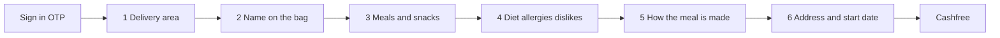
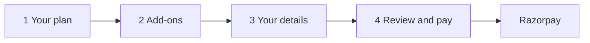

# Subscription journeys

A reference only, from screenshots of two other meal subscriptions. It records how those checkouts work. It does not change Native Meals pages, prices, or the enquiry.

Names, phone numbers, email addresses, and street lines from the review screens stay out of this note. The fields are listed. The values are not.

## The Healthy Craft

Site: `app.thehealthycraft.com`. The shots are a composite. Sign-in shows one mobile number. Cashfree shows another. The meal step appears once with breakfast, lunch and dinner, and later with dinner off and two snacks on. The pay total matches the second selection.

Progress is six steps after the phone screen. Payment is a Cashfree modal on the last step.

**Sign in** (`/sign-in`). The headline is "Food that knows your numbers." The service is pure vegetarian, with calories and macros on every plate. The visitor enters an Indian mobile number with a +91 prefix, then sends an OTP. Continuing agrees to the Terms and the Privacy Policy. The OTP screen itself is absent from the shots.

**1/6 Delivery area** (`/delivery-check`). The area is checked before the flat number. A yes for Indiranagar states the windows: breakfast 07:00–09:00, lunch 12:00–14:00, dinner 19:00–21:00. The visitor continues, or tries a different address. The screen where the area was typed is absent from the shots.

**2/6 Name** (`/name`). One field. The name is printed on the delivery bag.

**3/6 Meals** (`/buy`). Each meal is its own line. Breakfast is from ₹209. Lunch and dinner are from ₹229. Checking one opens the days (Mon–Fri or Mon–Sat) and the length (3 days, 1 week, 2 weeks, 1 month). Mon–Sat for 1 month is 26 plates. 26 × ₹209 = ₹5,434. 26 × ₹229 = ₹5,954. Snacks need a parent meal. The mid-morning snack comes with breakfast. The evening snack comes with lunch. Each is ₹120, for the same count, with a plus and a minus. 26 × ₹120 = ₹3,120. The sticky bar on the snack shot reads "4 things, 52 deliveries. Sundays off. Coupon at checkout." ₹17,628 is breakfast, lunch, and both snacks. Dinner is unchecked in that shot. 52 is the two meal drops, 26 + 26. The snacks ride with them.

**4/6 Plate rules.** The route is cropped in the shot. The visitor picks one diet: no particular diet, Sattvik (no onion or garlic), Jain (also nothing grown under the ground), or Vegan (no dairy, ghee, or honey). Sattvik and Jain are one choice. Jain is the stricter. Jain carries an amber note that few of the week's dishes qualify, and that the kitchen will call. Allergy chips are dairy, gluten, soy, and tree nuts. A comma-separated field collects foods to leave off. The step can be left empty. Copy says a change applies from the next meal the kitchen has not started.

**5/6 How it is made** (`/meal-preferences`). Carb is multigrain chapatis with a count (shown as 3 × 100 kcal, P 3.5g) and optional ghee (+8 kcal each), or brown rice at 240 g, or steamed rice at 240 g. Each rice line shows kcal and protein. Protein is paneer, tofu or soya, or Any. Packaging is eco-friendly containers with no deposit, already selected. Steel tiffins are marked currently unavailable. Copy says these can change later, including for a single day. Any keeps the kitchen rotation.

**6/6 Delivery details** (`/delivery-details`). Indiranagar is already checked, with a way to change it. The exact door is required before anything is charged, by setting the address on the map. The start date is tomorrow once today's lunch has closed. The shot shows lunch closed at 8:00 am, Thursday 29 dim, and Friday 30 selected. A coupon link sits above the same four lines and ₹17,628. The button is Pay.

**Address sheet**, still on `/delivery-details`. Search works in the Google style, or the visitor uses the current location. The pin stays fixed and the map moves under it. Then the form asks for the flat, the building, a landmark, Home / Office / Other, and where to leave the bag.

**Pay.** A Cashfree modal offers a UPI QR, card, wallets, net banking, RTGS/NEFT/IMPS, EMI, and cardless EMI, plus a Paytm cashback offer.

## Rasamrit

Route in the payment shot: `rasamrit.in/food-subscription`. Four steps, with the same summary card on the right the whole way. A bar above the steps says delivery across Bengaluru, 3, 14 and 28-day plans, and secure online payment. These shots include no phone OTP. The page states Bengaluru as available. It does not run a yes-or-no area check before the details.

**1 Your plan.** The heading is "Build your Rasamrit plan." Duration is 3, 14, or 28 days. In the shot, 28 is selected. Meals per day is 1, 2, or 3, counted as a number rather than named breakfast, lunch, or dinner. In the shot, 1 is selected. Preference is Veg or Non-Veg. In the shot, Veg is selected. The primary goal leaves the price unchanged. The choices are Healthy Eating, Weight Loss, Weight Management, Muscle Gain / High Protein, Diabetes-Friendly Meals, PCOS / Hormone-Friendly Meals, Senior / Elderly Nutrition, and Custom / Other. Copy says the goal helps the team plan meals. On the shown selection the card reads ₹449/day, base ₹449/day plus add-ons ₹0/day, and a plan total of ₹12,572. That is 449 × 28. One scheduled delivery per day is included. Other durations and meal counts stayed closed, so this note records only the rate on screen.

**2 Add-ons.** Extras are optional. The quantity applies to every day of the plan and travels with the scheduled delivery. With quantity set to None, the list is cold-pressed juice ₹149, detox water ₹70, smoothie ₹199, fruit bowl ₹149, overnight oats ₹199, and salad ₹199, each per serving per day. Add-ons have no separate delivery charge. A WhatsApp button sits on the page.

**3 Your details.** The form asks for a full name, a 10-digit mobile number, an email, a free-text delivery address, a 6-digit pincode, and a preferred start date. The Rasamrit team confirms the start date later. Google Maps is optional: paste a link, or use the current location. There is no pin-drag map. Copy says the detailed health profile comes after payment, and that the final meal schedule and delivery details are confirmed after a profile review. A banner says delivery is available across Bengaluru.

**4 Review and pay.** An unfinished subscription can be restored, or cleared with Start over. The review repeats the plan: 28 days, 1 meal a day, Veg, Healthy Eating, ₹449/day, no add-ons, ₹12,572. It also repeats the contact fields, with a way to edit them. The screen publishes four rules. One scheduled delivery per day is included. Extra delivery requests are charged at the actual delivery cost. Plan changes or pauses need at least 24 hours' notice. Payment is online only. The button is Proceed to Secure Payment. Razorpay collects the money. The health profile is collected after payment.

**Pay.** The Razorpay modal is for ₹12,572. It offers UPI, cards, EMI, net banking, a wallet, and a UPI QR with a countdown, plus bank and wallet offers.

## Where Native Meals stands

The builder is one page, [components/plans/PlanExperience.tsx](../components/plans/PlanExperience.tsx), then [components/forms/EnquiryForm.tsx](../components/forms/EnquiryForm.tsx). [Product](product.md) is explicit. The site explains the service and takes an enquiry. It does not take payment, start a subscription, or check an address.

Meals are breakfast, lunch, and dinner, on one duration for the whole plan: 1 meal, 3 days, Mon–Fri (5), 6 days (Saturday included), 2 weeks (12), a weekday month (22), and a monthly plan (24). One day pattern covers every selected meal. There is no per-meal day pattern, no meals-per-day bundle, no snacks, and no daily add-ons. Sunday is already off. A 28-day run of every calendar day is not a Native Meals length.

Rates in [data/plans.ts](../data/plans.ts) are flat per plate: breakfast ₹149, lunch and dinner ₹229 for veg and ₹249 for non-veg. The diet choice is veg, non-veg, or either. Either is priced at the veg rate. There is no goal that leaves the price alone, and no Sattvik, Jain, vegan, allergy, dislike, chapati count, or rice choice. [Business](business.md) says not to invent calorie numbers, protein numbers, a weight-loss claim, or a medical plan. Rasamrit's goal list stays in this note.

The form asks for a name, a 10-digit mobile number, a locality, office or home, the address, and the day they want the first tiffin. Both places asks for the office and the home. It does not ask for an email, an OTP, or a pincode, and it does not keep an unfinished checkout. The server recalculates the estimate. The enquiry goes out through a webhook or a WhatsApp link. Price and the handover spot are confirmed with the person before the first meal. Rasamrit also confirms the start date after the form, and only after online payment. The Healthy Craft charges only after the map pin, and moves the first day to tomorrow once lunch has closed.

The service area is Hinjewadi, Wakad, and Baner, typed as a locality. It is not a Bengaluru-wide claim, a radius yes or no, or a map pin. Eco-friendly containers are a kitchen rule on the site, not a checkout choice. Pause and change terms are explained when someone enquires. They are not published as a 24-hour rule. A lunch cutoff is printed only when its env var is set. It does not block a start date on the form.

## What this note leaves alone

OTP, maps, Cashfree, Razorpay, snacks, add-ons, health goals, and plate customisation stay off the Native Meals site. So do both platforms' prices, cities, calorie figures, and medical wording. This file is a reference. The pages keep their own facts.
