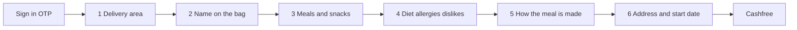
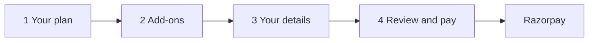
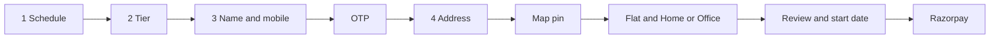

# Subscription journeys

A reference only. Each section records what that service leads with, then how the checkout works. The Healthy Craft and Rasamrit notes come from screenshots. The Wellfed note comes from the public site on 1 Nov 2026, and payment was not completed. It does not change Native Meals pages, prices, or the enquiry.

Names, phone numbers, email addresses, and street lines from the review screens stay out of this note. The fields are listed. The values are not.

## The Healthy Craft

Site: `app.thehealthycraft.com`. The shots are a composite. Sign-in shows one mobile number. Cashfree shows another. The meal step appears once with breakfast, lunch and dinner, and later with dinner off and two snacks on. The pay total matches the second selection.

**USPs.**

- The line they lead with is "Food that knows your numbers." Every plate shows calories and macros.
- The menu is pure vegetarian.
- The customer builds the plate: Sattvik, Jain, or vegan, allergy chips, foods to leave off, a chapati count or a weighed rice, paneer, tofu, or soya, and optional ghee. A change can apply to one day.
- Breakfast, lunch, and dinner are separate lines. A snack exists only with a parent meal.
- The name on the bag is its own step. The area is accepted, with a stated window, before the flat is taken.
- Sunday is off. A coupon waits until checkout.

Progress is six steps after the phone screen. Payment is a Cashfree modal on the last step.

**Sign in** (`/sign-in`). The headline is "Food that knows your numbers." The service is pure vegetarian, with calories and macros on every plate. The visitor enters an Indian mobile number with a +91 prefix, then sends an OTP. Continuing agrees to the Terms and the Privacy Policy. The OTP screen itself is absent from the shots.

**1/6 Delivery area** (`/delivery-check`). The area is checked before the flat number. A yes for Indiranagar states the windows: breakfast 07:00–09:00, lunch 12:00–14:00, dinner 19:00–21:00. The visitor continues, or tries a different address. The screen where the area was typed is absent from the shots.

**2/6 Name** (`/name`). One field. The name is printed on the delivery bag.

**3/6 Meals** (`/buy`). Each meal is its own line. Breakfast is from ₹209. Lunch and dinner are from ₹229. Checking one opens the days (Mon–Fri or Mon–Sat) and the length (3 days, 1 week, 2 weeks, 1 month). Mon–Sat for 1 month is 26 plates. 26 × ₹209 = ₹5,434. 26 × ₹229 = ₹5,954. Snacks need a parent meal. The mid-morning snack comes with breakfast. The evening snack comes with lunch. Each is ₹120, for the same count, with a plus and a minus. 26 × ₹120 = ₹3,120. The sticky bar on the snack shot reads "4 things, 52 deliveries. Sundays off. Coupon at checkout." ₹17,628 is breakfast, lunch, and both snacks. Dinner is unchecked in that shot. 52 is the two meal drops, 26 + 26. The snacks ride with them.

**4/6 Plate rules.** The route is cropped in the shot. The visitor picks one diet: no particular diet, Sattvik (no onion or garlic), Jain (also nothing grown under the ground), or Vegan (no dairy, ghee, or honey). Sattvik and Jain are one choice. Jain is the stricter. Jain carries an amber note that few of the week's dishes qualify, and that the kitchen will call. Allergy chips are dairy, gluten, soy, and tree nuts. A comma-separated field collects foods to leave off. The step can be left empty. Copy says a change applies from the next meal the kitchen has not started.

**5/6 How it is made** (`/meal-preferences`). Carb is multigrain chapatis with a count (shown as 3 × 100 kcal, P 3.5g) and optional ghee (+8 kcal each), or brown rice at 240 g, or steamed rice at 240 g. Each rice line shows kcal and protein. Protein is paneer, tofu or soya, or Any. Packaging is eco-friendly containers with no deposit, already selected. Steel tiffins are marked currently unavailable. Copy says these can change later, including for a single day. Any keeps the kitchen rotation.

**6/6 Delivery details** (`/delivery-details`). Indiranagar is already checked, with a way to change it. The exact door is required before anything is charged, by setting the address on the map. The start date is tomorrow once today's lunch has closed. The shot shows lunch closed at 8:00 am, Thursday 29 dim, and Friday 30 selected. A coupon link sits above the same four lines and ₹17,628. The button is Pay.

**Address sheet**, still on `/delivery-details`. Search works in the Google style, or the visitor uses the current location. The pin stays fixed and the map moves under it. Then the form asks for the flat, the building, a landmark, Home / Office / Other, and where to leave the bag.

**Pay.** A Cashfree modal offers a UPI QR, card, wallets, net banking, RTGS/NEFT/IMPS, EMI, and cardless EMI, plus a Paytm cashback offer.

## Rasamrit

Route in the payment shot: `rasamrit.in/food-subscription`. Four steps, with the same summary card on the right the whole way. A bar above the steps says delivery across Bengaluru, 3, 14 and 28-day plans, and secure online payment. These shots include no phone OTP. The page states Bengaluru as available. It does not run a yes-or-no area check before the details.

**USPs.**

- The first choice is a health goal: healthy eating, weight loss, weight management, muscle gain, diabetes-friendly, PCOS, senior nutrition, or custom. The goal does not change the price. Copy says it helps the team plan the meals.
- Veg or non-veg is a plan choice. Meals per day are a count, 1, 2, or 3, not named breakfast, lunch, and dinner.
- Juice, detox water, a smoothie, a fruit bowl, overnight oats, and a salad can ride with the scheduled delivery. They have no separate delivery charge.
- The public bar says delivery across Bengaluru. The team confirms the start date, the health profile, and the schedule after payment.
- A pause or a plan change needs 24 hours. Payment is online only. One scheduled delivery a day is included.

**1 Your plan.** The heading is "Build your Rasamrit plan." Duration is 3, 14, or 28 days. In the shot, 28 is selected. Meals per day is 1, 2, or 3, counted as a number rather than named breakfast, lunch, or dinner. In the shot, 1 is selected. Preference is Veg or Non-Veg. In the shot, Veg is selected. The primary goal leaves the price unchanged. The choices are Healthy Eating, Weight Loss, Weight Management, Muscle Gain / High Protein, Diabetes-Friendly Meals, PCOS / Hormone-Friendly Meals, Senior / Elderly Nutrition, and Custom / Other. Copy says the goal helps the team plan meals. On the shown selection the card reads ₹449/day, base ₹449/day plus add-ons ₹0/day, and a plan total of ₹12,572. That is 449 × 28. One scheduled delivery per day is included. Other durations and meal counts stayed closed, so this note records only the rate on screen.

**2 Add-ons.** Extras are optional. The quantity applies to every day of the plan and travels with the scheduled delivery. With quantity set to None, the list is cold-pressed juice ₹149, detox water ₹70, smoothie ₹199, fruit bowl ₹149, overnight oats ₹199, and salad ₹199, each per serving per day. Add-ons have no separate delivery charge. A WhatsApp button sits on the page.

**3 Your details.** The form asks for a full name, a 10-digit mobile number, an email, a free-text delivery address, a 6-digit pincode, and a preferred start date. The Rasamrit team confirms the start date later. Google Maps is optional: paste a link, or use the current location. There is no pin-drag map. Copy says the detailed health profile comes after payment, and that the final meal schedule and delivery details are confirmed after a profile review. A banner says delivery is available across Bengaluru.

**4 Review and pay.** An unfinished subscription can be restored, or cleared with Start over. The review repeats the plan: 28 days, 1 meal a day, Veg, Healthy Eating, ₹449/day, no add-ons, ₹12,572. It also repeats the contact fields, with a way to edit them. The screen publishes four rules. One scheduled delivery per day is included. Extra delivery requests are charged at the actual delivery cost. Plan changes or pauses need at least 24 hours' notice. Payment is online only. The button is Proceed to Secure Payment. Razorpay collects the money. The health profile is collected after payment.

**Pay.** The Razorpay modal is for ₹12,572. It offers UPI, cards, EMI, net banking, a wallet, and a UPI QR with a countdown, plus bank and wallet offers.

## Wellfed

Site: `www.bewellfed.in`. WELLFED BY BODYRX LLP sells a prepaid lunch and dinner subscription in parts of Bengaluru. The marketing site, the purchase wizard, a customer web app at `app.bewellfed.in`, and a mobile app are separate. Login is a mobile OTP. Support is phone and WhatsApp on +91 8043284198, and email at hello@bewellfed.in, Monday to Saturday, 9am to 7pm. The published kitchen address is BHIVE Premium, Indiranagar. FSSAI and GSTIN sit in the footer.

**USPs.**

- Homely Indian meals, sold as fresh and calorie-counted. The 2-week and 1-month plans add nutritionist guidance. The 3-day trial does not.
- Two menus. Everyday Indian is a salad, a dal, a vegetable, a protein, and a carb. Specials is wraps, biryani, and Indo-Chinese.
- Protein and carb are chosen after purchase: paneer, soya, tofu, egg, or chicken, and the roti of the day, brown rice, or white rice.
- Lunch and dinner are separate, and each has its own Monday-to-Saturday days. A longer plan costs less per meal. Delivery is included. A skip before 10pm the day before carries the meal forward, with no stated cap.
- The kitchen line is no refined oil, no additives, and reusable containers. Skips and plate choices are changed in the account, on the web app or the mobile app.

The public offer is two drops a day, lunch and dinner, Monday to Saturday. Sunday is closed. There is no breakfast. The terms say a plan includes up to two meals a day. The checkout review code also knows an evening snack. The public plans and FAQs name only lunch and dinner.

Homepage order: the hero ("Healthy, Fresh Meals, Delivered Daily!"), benefit cards, two marquees (no refined oil, no additives, protein, fresh cooking; then reusable and plant-based packaging), a 3-day-trial call to action, four steps (explore the menu, build a subscription, eat from reusable containers, manage skips in the account), three price cards, then FAQs.

Nav is Plans, Delivery Areas, Menu (Everyday Indian and Specials), Contact, Login, and "Get A 3-Day Trial". Every plan button goes to `/purchase`. That page refuses a desktop width and shows a QR code. The wizard runs at phone width.

The menu is public.

**Everyday Indian** (`/menu/everyday-indian`). One plate for lunch and one for dinner, Monday to Saturday. A typical plate is a salad, a dal, a vegetable, a protein slot, and a carb slot. Protein on the menu is paneer, soya, tofu, egg, or chicken. The menu copy also says egg whites. Carb is the roti of the day (bajra, ragi, multigrain, oats, and similar), brown rice, or white rice. The visitor picks these after purchase, inside the account, not in the builder.

**Specials** (`/menu/specials`). A second week of wraps, biryani, Indo-Chinese, and parathas, split veg or chicken rather than five proteins.

**Price cards.** The homepage and `/plans` show the same three. A longer plan costs less per meal. Delivery is included. All three say Monday to Saturday, lunch and dinner, and unlimited carry-forward.

- 3 days is ₹289 per meal. There is no nutritionist line. The trial is non-refundable.
- 2 weeks is ₹279 per meal, plus nutritionist guidance.
- 1 month is ₹269 per meal, plus nutritionist guidance.

Checkout adds 5% GST on `(meals × rate − coupon)` and labels the total inclusive of tax. The sticker rate is the pre-tax number. A coupon field exists on the pay step.

The wizard is four steps. A sub-step keeps the same step number. The names below are the analytics names in the page script.

**1 Schedule.** Lunch and dinner are separate checkboxes. Each opens Monday to Saturday. Checking a meal selects all six days. Days can be turned off. At least one meal is required. Days belong to that meal. One pattern does not cover the whole plan.

**2 Tier.** The heading is "Which subscription would you like?" Each card shows a per-meal price and a meal count. The copy includes "Unlimited Meal Carry Forward".

**3 Account.** The form asks for a full name and an Indian mobile number. Sending the OTP agrees to the privacy policy. The code is six digits, by SMS. An existing customer is sent to the app to renew. An account with more than one subscription cannot renew online, and the screen tells them to contact support.

**4 Address.** Search, then a map pin. A point outside the Bengaluru coverage polygon is blocked. The details are house or flat, apartment or building, landmark, and save as Home or Office. Copy says a different address per meal can be set later. A timings sheet says lunch about 10am to 1pm and dinner about 6pm to 8pm, and that meals may not arrive hot.

**Review.** The screen repeats the plan, links the short policy, and asks for a start date. Sunday and some blocked dates cannot be a start date. Razorpay then offers UPI, cards, net banking, and wallets. Acceptance of the order comes after payment and a serviceability check. Someone from Wellfed may call to confirm the address.

**After payment.** Skips, address changes, and meal preferences live in the web app and the mobile app. Protein and carb choices change there. The cutoff for a skip, an address, and preferences is 10:00pm IST the day before. After that, the meal counts as served, and the address and preferences lock.

A valid skip or pause extends the subscription until the paid meals are delivered. A pause needs an end date. There is no indefinite pause, and a pause is not a cash refund. Termination is a WhatsApp request. Deliveries pause for six days, then the refund covers unused meals that were not already prepared. Delivered meals are repriced at ₹299 plus 5% GST, which is ₹314, and any discount or referral is forfeited. Their worked example: paid ₹12,500 for 48 meals, 8 delivered, refund ₹9,988. Refunds are requested on WhatsApp and take 7 to 10 working days. A quality issue must be reported within 4 hours. The usual remedy is an extension.

**Delivery.** The policy page and the checkout copy disagree. `/delivery` says lunch 10:30am to 1:30pm and dinner 5:30pm to 8:30pm. The wizard says roughly 10am to 1pm and 6pm to 8pm, and that some areas are earlier. Neither guarantees a clock time. A same-day delivery outside the window gets no compensation.

There is no Sunday delivery. Public holidays are discretionary, with advance notice. Coverage is a map at `/delivery-areas`: certain residential communities and office complexes, not all of Bengaluru. The rider calls and may wait 10 minutes. If the customer is missing, the bag can be left at security or marked failed, and the meal is still charged. A Wellfed miss is treated as a skip and is not charged.

## Where Native Meals stands

**USPs.** These are the lines [Business](business.md) allows the site to say.

- Daily healthy meals for people working and living in Hinjewadi, Wakad, and Baner. Lunch is for the office gate. Dinner is for the PG or the flat. Breakfast sits on the all-day mix.
- Meals are cooked the morning they go out, and handed over at a gate, a security desk, or a door.
- One rate per plate. The length does not discount it. Veg and non-veg lunch and dinner are different prices. Breakfast is one rate.
- The kitchen rules that hold for every meal: no potatoes, no maida, no preservatives, and no non-stick. Rotis are millet or multigrain. Meals travel in an eco-friendly box.
- Starting is an enquiry. Price, address, and the first day are confirmed with the person before a meal is charged.

The builder is one page, [components/plans/PlanExperience.tsx](../components/plans/PlanExperience.tsx), then [components/forms/EnquiryForm.tsx](../components/forms/EnquiryForm.tsx). [Product](product.md) is explicit. The site explains the service and takes an enquiry. It does not take payment, start a subscription, or check an address.

Meals are breakfast, lunch, and dinner. Days are Monday to Friday or Monday to Saturday. Lunch and dinner can use different days. Breakfast follows lunch, or dinner when lunch is off. A single meal, or breakfast with only one of the other two, uses one pattern. Lengths are 3 days (3 of each selected meal), 2 weeks (10 or 12 of that meal), and 4 weeks (20 or 24). There is no meals-per-day bundle, no snacks, and no daily add-ons. Sunday is already off. A 28-day run of every calendar day is not a Native Meals length.

Rates in [data/plans.ts](../data/plans.ts) are flat per plate: breakfast ₹149, lunch and dinner ₹229 for veg and ₹249 for non-veg. The diet choice is veg, non-veg, or either. Either is priced at the veg rate. There is no goal that leaves the price alone, and no Sattvik, Jain, vegan, allergy, dislike, chapati count, or rice choice. [Business](business.md) says not to invent calorie numbers, protein numbers, a weight-loss claim, or a medical plan. Rasamrit's goal list stays in this note.

The form asks for a name, a 10-digit mobile number, a locality, office or home, the address, and the day they want the first tiffin. Both places asks for the office and the home. It does not ask for an email, an OTP, or a pincode, and it does not keep an unfinished checkout. The server recalculates the estimate. The enquiry goes out through a webhook or a WhatsApp link. Price and the handover spot are confirmed with the person before the first meal. Rasamrit also confirms the start date after the form, and only after online payment. The Healthy Craft charges only after the map pin, and moves the first day to tomorrow once lunch has closed. Wellfed charges before the first meal, on Razorpay, after the map pin.

Wellfed's rate falls with the length: ₹289, ₹279, then ₹269 per meal. Native Meals keeps one rate per plate. Wellfed is lunch and dinner, and the days are chosen on each meal. Native Meals can include breakfast. Lunch and dinner can use different Monday-to-Friday or Monday-to-Saturday patterns. Wellfed customises protein and carb after payment, and the marketing site publishes calories and a nutritionist. Those stay off the Native Meals site. [Business](business.md) already forbids inventing them.

The service area is Hinjewadi, Wakad, and Baner, typed as a locality. It is not a Bengaluru-wide claim, a radius yes or no, or a map pin. Eco-friendly boxes are how the meal is handed over, not a checkout choice. Pause and cancellation are explained when someone enquires. A skip cutoff, once set, says that meal is carried to the end of the plan. It is not Wellfed's 10pm rule. A lunch cutoff is printed only when its env var is set. It does not block a start date on the form.

## What this note leaves alone

OTP, maps, Cashfree, Razorpay, snacks, the Wellfed evening-snack path, add-ons, health goals, nutritionist claims, and plate customisation stay off the Native Meals site. So do all three platforms' prices, cities, calorie figures, and medical wording. The USP lines record what each service publishes. They are not copied onto Native Meals pages. This file is a reference. The pages keep their own facts.
